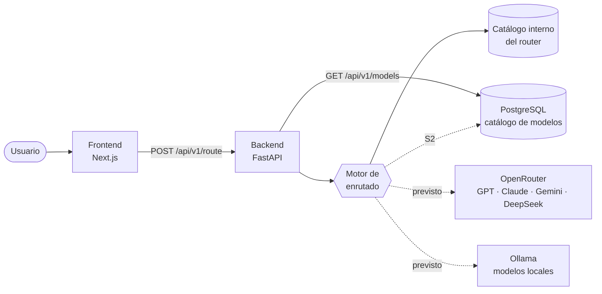

# AI Router

**Describes una tarea y AI Router decide qué modelo de IA usaría, y explica por qué.** Hoy decide con reglas de palabras clave sobre un catálogo de ejemplo; el objetivo es equilibrar coste, calidad, latencia y privacidad.

[English](README.md) · Español


> **Estado actual.** El flujo completo funciona de extremo a extremo: interfaz → API → motor de enrutado → decisión explicada en pantalla. El catálogo de modelos y su histórico de precios viven en PostgreSQL y se muestran en la página Models. Lo que todavía no es real: las decisiones salen de reglas por palabras clave, el router aún usa su propio catálogo interno con precios simulados y el dashboard muestra datos de ejemplo. Todavía no se llama a ningún proveedor de IA. Más detalle en [Limitaciones conocidas](#limitaciones-conocidas).

---

## Por qué existe

Quería aprovechar mejor las IAs que uso para estudiar, programar y construir proyectos.

El ecosistema cambia constantemente. Aparecen modelos nuevos. Cambian los precios. Cambian las capacidades.

AI Router nace primero como una herramienta para centralizar esa decisión para mí misma y después como una plataforma que pueda ayudar a otras personas con el mismo problema.

## El problema

Hay muchos modelos de IA útiles, y cada uno tiene precios, ventanas de contexto y puntos fuertes distintos. A eso se suman los modelos que se pueden ejecutar en local con Ollama: sin coste por petición, pero no siempre al mismo nivel.

Sin un criterio claro, es fácil acabar usando siempre el mismo modelo: el más potente, pagando de más por tareas sencillas, o el más barato, aceptando peores respuestas cuando la tarea lo necesita. AI Router intenta automatizar esa elección y explicar cada decisión.

## En qué se diferencia

- **De usar directamente un asistente.** Algunos asistentes ya eligen modelo automáticamente, pero solo entre los suyos. AI Router compara modelos de varios proveedores y muestra el coste estimado de cada decisión.
- **De OpenRouter Auto.** OpenRouter también puede elegir el modelo por ti. El objetivo de AI Router es que cada decisión sea explicable y siga reglas propias (presupuesto, privacidad, modelos permitidos), con la opción de usar modelos locales.
- **Lo que existe hoy** es la parte explicable. Las reglas propias, la privacidad y los modelos locales están en el roadmap.

## Cómo funciona



<sub>Líneas continuas: funciona hoy. Discontinuas: diseñado, pendiente de implementar.</sub>

- **Frontend (Next.js).** Un Playground donde describes una tarea, una página Models con el catálogo persistente y un dashboard con métricas de ejemplo. Cada decisión muestra qué modelo se eligió y por qué: complejidad estimada, coste estimado y motivo.
- **Backend (FastAPI).** Valida cada petición y se la pasa al motor de enrutado. Expone una API versionada (`/api/v1`) documentada con OpenAPI.
- **Motor de enrutado.** Analiza el prompt con reglas de palabras clave y estima su complejidad y su coste. El objetivo es que filtre los modelos válidos (contexto, privacidad, presupuesto) y puntúe los candidatos por calidad, coste y latencia.
- **Base de datos (PostgreSQL).** Guarda el catálogo de modelos y su histórico de precios, con migraciones de Alembic y acceso asíncrono (SQLAlchemy + asyncpg). El router todavía no la usa; esa conexión forma parte de S2.
- **Proveedores de IA (previsto).** OpenRouter para los modelos comerciales y Ollama para los locales. Los dos ofrecen una API compatible con la de OpenAI, así que debería bastar un único adaptador para ambos.

Una decisión real del sistema hoy:

```text
Prompt:       "Diseña una arquitectura cloud escalable"

Modelo:       Claude Sonnet (Anthropic)
Complejidad:  8/10
Coste:        ~0,018 € · 1.210 tokens estimados
Motivo:       Arquitectura software avanzada  [arquitectura]
```

## Qué funciona hoy

- Playground conectado al backend real, con estados de carga, error y reintento.
- Tarjeta de decisión: modelo, proveedor, complejidad, coste estimado, motivo y palabras clave detectadas.
- Motor de enrutado por reglas, con estimación de complejidad y coste.
- Catálogo persistente de modelos en PostgreSQL: proveedor, ventana de contexto, estado y precio vigente, con histórico de precios. Se expone en `GET /api/v1/models` y se muestra en la página Models.
- Migraciones con Alembic y un seed idempotente con modelos de ejemplo.
- La interfaz no se rompe si el backend devuelve un modelo que no conoce.
- API versionada (`/api/v1`), configuración centralizada y logs estructurados en JSON.
- Contrato OpenAPI exportado y comprobado por un test.
- Docker Compose con frontend, backend y PostgreSQL; el backend aplica las migraciones y el seed al arrancar.
- Dashboard con métricas **de ejemplo**: el diseño es real, los datos no.

## Limitaciones conocidas

- **Tres fuentes de datos de modelos.** El router usa su catálogo interno (€ por cada 1.000 tokens), la página Models usa PostgreSQL (precios de ejemplo en USD por millón de tokens) y el dashboard usa datos de ejemplo. Unificarlas es parte de S2.
- **Precios de ejemplo.** Los precios del seed no son tarifas reales de los proveedores.
- **Formato de `DATABASE_URL`.** Tiene que usar el driver asíncrono (`postgresql+asyncpg://…`). Otros formatos, como el habitual `postgresql://…`, impiden que el backend arranque.
- **Sin timeout de conexión a la base de datos.** Si el host de la base de datos no responde, `GET /api/v1/models` puede tardar unos 60 segundos en devolver un 503; el frontend deja de esperar a los 15 segundos.
- **Sin respuestas reales.** El Playground muestra la decisión; no llama al modelo elegido.

## Decisiones técnicas

Qué me aporta cada tecnología y qué me cuesta.

**Next.js.** Un único proyecto para la interfaz y, más adelante, una capa de servidor propia (BFF) para que las claves y las sesiones nunca lleguen al navegador.
*Coste:* el framework evoluciona rápido, y algunos detalles (como que las variables `NEXT_PUBLIC_*` se fijen al compilar) condicionan el despliegue.

**FastAPI (Python).** La mayor parte de las herramientas de IA están en Python: SDKs, embeddings y clasificadores. Pydantic valida cada petición y genera el esquema OpenAPI, que es la base del contrato con el frontend.
*Coste:* dos lenguajes en el mismo producto. Un contrato comprobado por un test los mantiene sincronizados.

**PostgreSQL.** Los datos son relacionales: modelos, precios con histórico y, más adelante, peticiones y equipos. La analítica necesitará agregaciones en SQL. Si llega el soporte multi-equipo (S4), Row-Level Security es una opción para aislar los datos.
*Coste:* más disciplina de esquema y migraciones que una base de datos documental.

**OpenRouter (previsto).** Una sola API para GPT, Claude, Gemini, DeepSeek y muchos más, con un catálogo de precios que se puede sincronizar. Evita mantener cinco integraciones desde el principio.
*Coste:* depender de un intermediario. Además, OpenRouter tiene su propio enrutado automático, así que este proyecto tiene que dejar claro dónde aporta valor: reglas, presupuestos, privacidad y decisiones explicables.

**Ollama (previsto).** Modelos locales sin coste por petición y, sobre todo, privacidad: hay datos que no deberían salir nunca de la infraestructura propia.
*Coste:* un servicio en la nube no puede llegar al `localhost` de un usuario. Hay que diseñar el despliegue (self-hosted, túnel o agente) antes de prometer esta funcionalidad.

## Cómo he usado la IA

Utilicé Claude Code, GitHub Copilot y otros asistentes para acelerar la implementación, realizar auditorías técnicas y explorar alternativas de diseño.

La definición del producto, las decisiones de arquitectura, el roadmap, las restricciones técnicas y la validación de cada sprint fueron responsabilidad mía.

La IA me permitió delegar parte de la escritura del código mientras mantenía el control sobre el diseño y la comprensión del sistema.

## Roadmap

| Fase | Objetivo | Estado |
|---|---|---|
| **Prototipo** | Interfaz de decisión, dashboard y enrutado por reglas de extremo a extremo | ✅ |
| **S0 · Fundaciones** | Configuración, logging, `/api/v1`, Docker, contrato OpenAPI | ✅ |
| **S0.5 · Producto** | Playground, navegación honesta, datos de ejemplo señalizados | ✅ |
| **S1 · Persistencia** | PostgreSQL, SQLAlchemy asíncrono, Alembic, catálogo de modelos con histórico de precios, página Models | ✅ |
| **S1.5 · Portfolio y open source** | Documentación, licencia, preparación de CI y de releases | 🚧 |
| **S2 · Ejecución real** | Router sobre el catálogo persistente, OpenRouter, streaming, registro de uso y coste reales, tipos generados | 🎯 |
| **S3 · Local e híbrido** | Ollama, health checks, cadenas de fallback, política de privacidad | 🎯 |
| **S4 · Multi-equipo** | Autenticación, organizaciones, API keys, límites de uso | 🎯 |
| **S5 · Router v2** | Puntuación coste/calidad/latencia, clasificador, evaluación con un dataset propio | 🎯 |
| **S6 · Analítica** | Dashboard real, presupuestos y alertas, ahorro medido | 🎯 |

## Lecciones aprendidas

- **Las reglas por palabras clave tienen un límite claro.** El motor elige la primera regla que coincide. "Hazme un resumen de este bug" acaba en el modelo de programación porque esa regla va antes que la de resúmenes. Para mejorar hace falta clasificar la tarea, no solo buscar palabras.
- **Un ahorro necesita una referencia.** El dashboard mostraba un "ahorro" sin decir respecto a qué. Ahora indica la línea base: lo que habría costado usar siempre el modelo de referencia.
- **Duplicar el catálogo rompía la interfaz.** En S0 lo moví al backend. Desde S1 conviven temporalmente tres fuentes de datos de modelos (el catálogo interno del router, PostgreSQL y los datos de ejemplo del dashboard); unificarlas es parte de S2.
- **Un contrato sin comprobar se desactualiza.** El esquema OpenAPI se exporta y un test falla si deja de coincidir con la API. Los tipos del frontend todavía se escriben a mano.
- **Las variables públicas de Next.js se fijan al compilar.** En Docker, la URL del backend queda dentro de la imagen; cambiarla obliga a reconstruirla.
- **Lo que funciona en mi máquina puede fallar en un clon limpio.** `tsc` fallaba sin los tipos que genera Next.js, y pytest cargaba plugins de ROS 2 instalados en el sistema. Ahora `npm run typecheck` ejecuta antes `next typegen`, y pytest desactiva la carga automática de plugins.
- **Una redirección permanente es difícil de deshacer.** `/chat` respondía con un 308, que los navegadores guardan en caché; la cambié a una redirección temporal para poder reutilizar la ruta.

Para ejemplos de problemas reales encontrados durante el desarrollo, consulta [docs/INCIDENTS.md](docs/INCIDENTS.md).

## Cómo ejecutarlo

Con Docker:

```bash
git clone https://github.com/sofia-casado-sainz/ai-router-dashboard.git
cd ai-router-dashboard
cp .env.example .env          # define POSTGRES_PASSWORD
docker compose up --build
```

Abre <http://localhost:3000/playground> y prueba con *"Diseña una arquitectura cloud escalable"*. La API está documentada en <http://localhost:8010/docs>.

Sin Docker (Python ≥ 3.11, Node ≥ 20 y un PostgreSQL accesible con las variables `POSTGRES_*` de `.env`):

```bash
cd backend && python -m venv .venv && source .venv/bin/activate
pip install -e ".[dev]"
alembic upgrade head && python scripts/seed_models.py
python main.py

cd frontend && npm install && npm run dev      # en otra terminal
```

Variables de entorno, tests, contrato de la API y estructura del código: [docs/DEVELOPMENT.md](docs/DEVELOPMENT.md).

## Licencia

MIT. Consulta [LICENSE](LICENSE).

## Autora

Sofía Casado Sainz, AI Engineer orientada a agentes de IA, automatización y sistemas de decisión.

- **GitHub:** [@sofia-casado-sainz](https://github.com/sofia-casado-sainz)
- **LinkedIn:** [sofia-casado-sainz](https://www.linkedin.com/in/sofia-casado-sainz-4094a028a)
