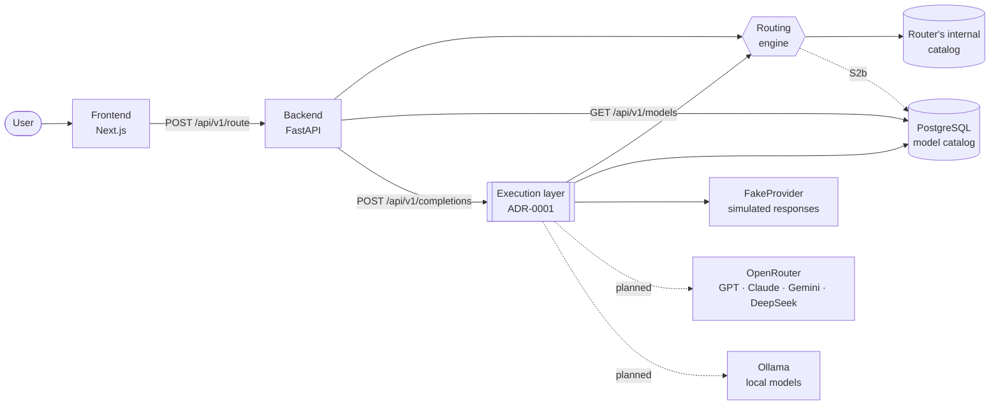

# AI Router

**Describe a task and AI Router decides which AI model it would use, and explains why.** Today it decides with keyword rules over an example catalog; the goal is to balance cost, quality, latency and privacy.

English · [Español](README.es.md)


> **Current status.** The full flow works end to end: interface → API → routing engine → decision explained on screen. The model catalog and its price history live in PostgreSQL and are shown on the Models page. `POST /api/v1/completions` can also execute the chosen model, but in S2 it only runs on a simulated provider (`FakeProvider`): the responses are simulated, cost nothing, and the endpoint is disabled by default. What is not real yet: decisions come from keyword rules, the router still uses its own internal catalog with simulated prices, and the dashboard shows sample data. No real AI provider (OpenRouter, Ollama) is called yet. Details in [Known limitations](#known-limitations).

---

## Why it exists

I wanted to make better use of the AI tools I use to study, write code and build projects. The ecosystem keeps changing: new models appear, prices change and capabilities change.

AI Router started as a tool to centralize that decision for myself, and later as a platform that could help other people with the same problem.

## The problem

There are many useful AI models, and each has different prices, context windows and strengths. On top of that there are local models you can run with Ollama: no cost per request, but not always at the same level.

Without a clear criterion, it is easy to always use the same model: the most capable one, paying too much for simple tasks, or the cheapest one, accepting weaker answers when the task needs more. AI Router tries to automate that choice and explain each decision.

## How it differs

- **From using one assistant directly.** Some assistants already pick a model automatically, but only among their own. AI Router compares models from several providers and shows the estimated cost of each decision.
- **From OpenRouter Auto.** OpenRouter can also pick a model for you. The goal of AI Router is that every decision is explainable and follows your own rules (budget, privacy, allowed models), with the option of using local models.
- **What exists today** is the explainable part. Custom rules, privacy policies and local models are on the roadmap.

## How it works



<sub>Solid lines: working today. Dashed lines: designed, not implemented yet.</sub>

- **Frontend (Next.js).** A Playground where you describe a task, a Models page with the persistent catalog, and a dashboard with sample metrics. Each decision shows which model was chosen and why: estimated complexity, estimated cost and the reason.
- **Backend (FastAPI).** Validates requests and passes them to the routing engine. Exposes a versioned API (`/api/v1`) documented with OpenAPI.
- **Routing engine.** Analyzes the prompt with keyword rules and estimates its complexity and cost. The goal is for it to filter valid models (context, privacy, budget) and score candidates by quality, cost and latency.
- **Database (PostgreSQL).** Stores the model catalog and its price history, with Alembic migrations and async access (SQLAlchemy + asyncpg). The router does not use it yet; that connection is part of S2b. The execution layer reads it to know where each model runs.
- **Execution layer ([ADR-0001](docs/adr/0001-inference-provider-abstraction.md)).** Separate from the router, which only decides. It resolves where the chosen model runs and calls that *inference provider* through a common interface, with normalized types, typed errors and timeouts. Today the only registered provider is `FakeProvider`, which returns simulated responses with no network and no cost.
- **AI providers (planned).** OpenRouter for commercial models (S2) and Ollama for local ones (S3). Both offer an OpenAI-compatible API, so a single adapter should be enough for both.

A real decision from the system today:

```text
Prompt:      "Diseña una arquitectura cloud escalable"

Model:       Claude Sonnet (Anthropic)
Complexity:  8/10
Cost:        ~€0.018 · 1,210 estimated tokens
Reason:      Arquitectura software avanzada  [arquitectura]
```

## What works today

- Playground connected to the real backend, with loading, error and retry states.
- Decision card: model, provider, complexity, estimated cost, reason and matched keywords.
- Rule-based routing engine with complexity and cost estimation.
- Persistent model catalog in PostgreSQL: provider, context window, status and current price, with price history. Exposed at `GET /api/v1/models` and shown on the Models page.
- Alembic migrations and an idempotent seed with example models.
- The interface does not break if the backend returns a model it does not know.
- Versioned API (`/api/v1`), centralized configuration and structured JSON logs.
- OpenAPI contract exported and checked by a test.
- Docker Compose with frontend, backend and PostgreSQL; the backend applies migrations and the seed on startup.
- Execution layer (ADR-0001): inference provider interface, provider registry, execution service with timeouts and typed errors, and a conformance suite every provider must pass.
- `POST /api/v1/completions`: decides like `/route` and executes the chosen model. Disabled by default (`COMPLETIONS_ENABLED=false`); when enabled, the response comes from `FakeProvider` (simulated, 0 USD).
- Dashboard with **sample** metrics: the layout is real, the data is not.

## Known limitations

- **Three sources of model data.** The router uses its internal catalog (€ per 1K tokens), the Models page uses PostgreSQL (example prices in USD per million tokens) and the dashboard uses sample data. Unifying them is part of S2b.
- **Example prices.** The seed prices are not real provider rates.
- **`DATABASE_URL` format.** It must use the async driver (`postgresql+asyncpg://…`). Other formats, such as the usual `postgresql://…`, stop the backend from starting.
- **No database connection timeout.** If the database host does not respond, `GET /api/v1/models` can take up to about 60 seconds to return a 503; the frontend gives up after 15 seconds.
- **Simulated answers only.** The Playground shows the decision and does not call any model. `POST /api/v1/completions` only runs on `FakeProvider`, which returns a simulated response at zero cost; OpenRouter (S2) and Ollama (S3) are not integrated yet.
- **Transitional model mapping.** The execution layer translates the router's ids to catalog models with a temporary table defined in ADR-0001 (for example, `gpt` → `openai/gpt-5`). It is architectural debt and goes away in S2b.

## Technical decisions

What each technology gives me and what it costs. Architecture decisions are recorded as ADRs in [docs/adr](docs/adr) (ADR-0001: inference provider abstraction).

**Next.js.** One project for the interface and, later, a server layer of its own (BFF) so that keys and sessions never reach the browser.
*Cost:* the framework moves fast, and some details (such as `NEXT_PUBLIC_*` variables being fixed at build time) affect deployment.

**FastAPI (Python).** Most AI tooling lives in Python: SDKs, embeddings and classifiers. Pydantic validates each request and generates the OpenAPI schema, which is the basis of the contract with the frontend.
*Cost:* two languages in one product. A contract checked by a test keeps them in sync.

**PostgreSQL.** The data is relational: models, prices with history and, later, requests and teams. The analytics will need SQL aggregations. If multi-team support arrives (S4), Row-Level Security is an option for isolating data.
*Cost:* more schema and migration discipline than a document database.

**OpenRouter (planned).** One API for GPT, Claude, Gemini, DeepSeek and many more, with a price catalog that can be synced. It avoids maintaining five integrations from the start.
*Cost:* depending on an intermediary. OpenRouter also has its own automatic routing, so this project needs to be clear about where it adds value: rules, budgets, privacy and explainable decisions.

**Ollama (planned).** Local models with zero cost per request and, above all, privacy: some data should never leave your own infrastructure.
*Cost:* a cloud service cannot reach a user's `localhost`. Deployment (self-hosted, tunnel or agent) has to be designed before promising this feature.

## How I used AI

I used Claude Code, GitHub Copilot and other assistants to speed up implementation, run technical audits and explore design alternatives.

Product definition, architecture decisions, the roadmap, technical constraints and the validation of each sprint were my responsibility.

AI let me delegate part of the code writing while I kept control over the design and my understanding of the system.

## Roadmap

| Phase | Goal | Status |
|---|---|---|
| **Prototype** | Decision interface, dashboard and rule-based routing end to end | ✅ |
| **S0 · Foundations** | Configuration, logging, `/api/v1`, Docker, OpenAPI contract | ✅ |
| **S0.5 · Product** | Playground, honest navigation, clearly labeled sample data | ✅ |
| **S1 · Persistence** | PostgreSQL, async SQLAlchemy, Alembic, model catalog with price history, Models page | ✅ |
| **S1.5 · Portfolio and open source** | Documentation, license, CI and release preparation | ✅ |
| **S2 · Execution foundation** | Execution layer (ADR-0001), `POST /api/v1/completions` with `FakeProvider`, OpenRouter provider | 🚧 |
| **S2b · Router on the catalog** | Router on top of the persistent catalog, real calls in public environments, streaming, usage and cost tracking, generated types | 🎯 |
| **S3 · Local and hybrid** | Ollama, health checks, fallback chains, privacy policy | 🎯 |
| **S4 · Multi-team** | Authentication, organizations, API keys, usage limits | 🎯 |
| **S5 · Router v2** | Cost/quality/latency scoring, classifier, evaluation with an own dataset | 🎯 |
| **S6 · Analytics** | Real dashboard, budgets and alerts, measured savings | 🎯 |

## Lessons learned

- **Keyword rules have a clear limit.** The engine picks the first rule that matches. "Hazme un resumen de este bug" ("summarize this bug for me") goes to the programming model because that rule comes before the summary rule. Going further requires classifying the task, not just looking for words.
- **Savings need a reference point.** The dashboard used to show "savings" without saying compared to what. It now states the baseline: what it would have cost to always use the reference model.
- **Duplicating the catalog broke the interface.** In S0 I moved it to the backend. Since S1, three sources of model data coexist for now (the router's internal catalog, PostgreSQL and the dashboard's sample data); unifying them is part of S2b.
- **An unchecked contract drifts.** The OpenAPI schema is exported and a test fails if it no longer matches the API. Frontend types are still written by hand.
- **Next.js public variables are fixed at build time.** In Docker, the backend URL ends up inside the image; changing it means rebuilding.
- **What works on my machine can fail on a clean clone.** `tsc` failed without the types Next.js generates, and pytest loaded ROS 2 plugins installed on the system. Now `npm run typecheck` runs `next typegen` first, and pytest disables plugin autoloading.
- **A permanent redirect is hard to undo.** `/chat` answered with a 308, which browsers cache; I changed it to a temporary redirect so the route can be reused.

For examples of real problems found during development, see [docs/INCIDENTS.md](docs/INCIDENTS.md) (in Spanish).

## Running it

With Docker:

```bash
git clone https://github.com/sofia-casado-sainz/ai-router-dashboard.git
cd ai-router-dashboard
cp .env.example .env          # set POSTGRES_PASSWORD
docker compose up --build
```

Open <http://localhost:3000/playground> and try *"Diseña una arquitectura cloud escalable"*. The API is documented at <http://localhost:8010/docs>.

To try `POST /api/v1/completions`, set `COMPLETIONS_ENABLED=true` in `.env`. It answers with `FakeProvider`: simulated responses, no API keys and no cost.

Without Docker (Python ≥ 3.11, Node ≥ 20 and a PostgreSQL reachable with the `POSTGRES_*` variables in `.env`):

```bash
cd backend && python -m venv .venv && source .venv/bin/activate
pip install -e ".[dev]"
alembic upgrade head && python scripts/seed_models.py
python main.py

cd frontend && npm install && npm run dev      # in another terminal
```

Environment variables, tests, the API contract and code structure: [docs/DEVELOPMENT.md](docs/DEVELOPMENT.md) (in Spanish).

## License

MIT. See [LICENSE](LICENSE).

## Author

I'm Sofía Casado Sainz, a fourth-year Computer Engineering student at Universidad Francisco de Vitoria (Pozuelo de Alarcón, Madrid), specializing in AI engineering: agent systems, intelligent automation, decision engines, LLM routing and inference platforms.

- **GitHub:** [@sofia-casado-sainz](https://github.com/sofia-casado-sainz)
- **LinkedIn:** [sofia-casado-sainz](https://www.linkedin.com/in/sofia-casado-sainz-4094a028a)
