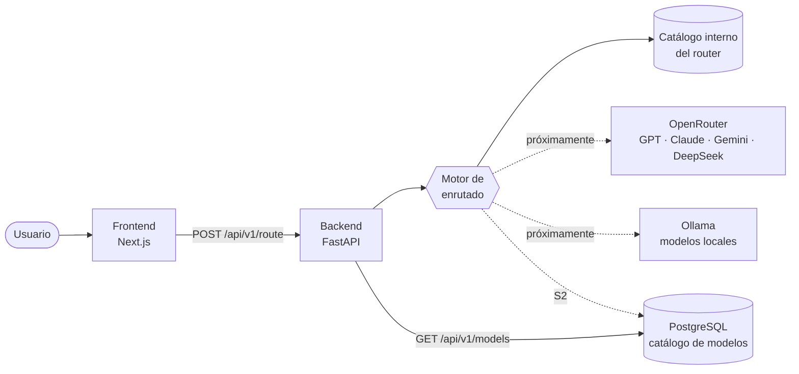

# AI Router Dashboard

**Escribes una tarea y el sistema decide qué modelo de IA debe resolverla, según coste, calidad, complejidad y privacidad.**


> **Estado actual.** El flujo completo funciona de extremo a extremo: interfaz → API → motor de enrutado → decisión explicada en pantalla. Desde el Sprint S1, el catálogo de modelos y sus precios viven en PostgreSQL y se consultan en la página Models. Lo que todavía no es real: la decisión se toma con reglas (no con un clasificador), el router aún usa su propio catálogo interno con precios simulados y las métricas del dashboard son datos de ejemplo. Aún no se llama a ningún proveedor de IA. Lo detallo más abajo, en [Qué funciona hoy](#qué-funciona-hoy).

---

## El problema

Hoy hay decenas de modelos de IA útiles, y elegir cuál usar para cada tarea se ha convertido en un problema en sí mismo.

GPT, Claude, Gemini y DeepSeek tienen precios, ventanas de contexto y puntos fuertes distintos. A eso se suman los modelos que puedes ejecutar en tu propia máquina con Ollama, que no cuestan nada por petición pero no siempre llegan al mismo nivel.

En la práctica, la mayoría de equipos hace una de estas dos cosas:

- **Usar siempre el modelo más potente**, y pagar precio premium por resumir un correo.
- **Usar siempre el más barato**, y aceptar malas respuestas en las tareas que de verdad importan.

Ninguna de las dos es una decisión: es la ausencia de una. Este proyecto intenta que esa elección sea automática, medible y explicable.

## Por qué lo estoy construyendo

Quería aprovechar mejor las IAs que uso para estudiar, programar y construir proyectos. El ecosistema cambia constantemente: aparecen modelos nuevos, cambian los precios y cambian las capacidades.

AI Router nace primero como una herramienta para centralizar esa decisión para mí mismo, y después como una plataforma que pueda ayudar a otras personas con el mismo problema.

Como proyecto, también quería que me obligara a trabajar como en un producto real:

- **Arquitectura full stack de verdad**: un frontend y un backend separados, con un contrato entre ellos que no se rompa en silencio.
- **El routing como problema de decisión**: cómo estimar la complejidad de una tarea, cómo comparar calidad y coste, y cómo explicar al usuario por qué se eligió un modelo.
- **Diseñar para crecer**: configuración, logging, versionado de API e infraestructura antes de que sean un problema.

## Cómo funciona



<sub>Líneas continuas: funciona hoy. Discontinuas: diseñado, pendiente de implementar.</sub>

- **Frontend (Next.js).** La parte que ve el usuario: un Playground donde describes una tarea y un dashboard de consumo y costes. Cada decisión muestra *qué* modelo se eligió y *por qué*: complejidad estimada, coste previsto y el motivo de la decisión.
- **Backend (FastAPI).** Recibe la petición, la valida y se la pasa al motor de enrutado. Expone una API versionada (`/api/v1`) y documentada automáticamente con OpenAPI.
- **Motor de enrutado.** El corazón del proyecto. Hoy analiza el prompt con reglas y estima su complejidad y su coste. El objetivo es que filtre los modelos válidos (contexto, privacidad, presupuesto) y puntúe los candidatos equilibrando calidad, coste y latencia.
- **Base de datos (PostgreSQL).** Desde S1 guarda el catálogo de modelos y su histórico de precios, con migraciones de Alembic y acceso asíncrono (SQLAlchemy + asyncpg). La página Models lo consulta a través de la API. El router todavía no lo usa: se conectará en S2. Más adelante guardará también el historial de peticiones y el consumo real por equipo.
- **Proveedores de IA.** OpenRouter dará acceso a los modelos comerciales con una sola integración, y Ollama a los modelos locales. Los dos hablan el mismo protocolo (compatible con OpenAI), así que un único adaptador sirve para ambos.

Así es una decisión real del sistema hoy:

```text
Prompt:  "Diseña una arquitectura cloud escalable"

Modelo:       Claude Sonnet (Anthropic)
Complejidad:  8/10
Coste:        ~0,018 € · 1.210 tokens estimados
Motivo:       Arquitectura software avanzada  [arquitectura]
```

## Qué funciona hoy

**✅ Implementado**
- Playground conectado al backend real, con estados de carga, error y reintento.
- Tarjeta de decisión: modelo, proveedor, complejidad, coste estimado y motivo.
- Motor de enrutado por reglas, con estimación de complejidad y coste.
- Catálogo persistente de modelos en PostgreSQL: proveedor, ventana de contexto, estado y precio vigente, con histórico de precios. Se expone en `GET /api/v1/models` y se muestra en la página Models.
- Migraciones con Alembic y un seed idempotente con modelos de ejemplo.
- La interfaz no se rompe si el backend devuelve un modelo que no conoce.
- API versionada (`/api/v1`), configuración centralizada y logs estructurados en JSON.
- Contrato OpenAPI exportado y protegido por un test.
- Docker Compose con frontend, backend y PostgreSQL; el backend aplica las migraciones y el seed al arrancar.
- Dashboard con métricas *de ejemplo*: el diseño es real, los datos todavía no.

**🔜 Siguiente (S2)**
- Conectar el router al catálogo persistente, para que haya una sola fuente de verdad de modelos y precios.
- Tipos TypeScript generados automáticamente desde OpenAPI.

**🎯 Objetivos**
- Respuestas reales vía OpenRouter, con streaming.
- Modelos locales con Ollama y una política de privacidad del tipo "lo sensible no sale de mi máquina".
- Motor de puntuación coste / calidad / latencia, configurable por equipo.
- Presupuestos con alertas y límite duro, y analítica de ahorro frente a una línea base.
- Endpoint compatible con OpenAI (`model: "auto"`), para usar el router desde cualquier aplicación existente.

## Decisiones técnicas

No elegí las tecnologías por moda. Esto es lo que me aporta cada una y lo que sacrifico a cambio.

**Next.js.** Me permite tener en un solo proyecto la interfaz y, más adelante, una capa de servidor propia (BFF) para que las claves y sesiones nunca lleguen al navegador. Los componentes de servidor encajan bien con un dashboard que carga datos agregados.
*Coste:* el framework evoluciona rápido, y algunas cosas (como las variables `NEXT_PUBLIC_*`, que se fijan al compilar) condicionan el despliegue.

**FastAPI (Python).** El ecosistema de IA vive en Python: SDKs, embeddings y clasificadores. Pydantic valida cada petición y genera el esquema OpenAPI sin esfuerzo, y ese esquema es la base del contrato con el frontend.
*Coste:* dos lenguajes en el mismo producto. Lo compenso con un contrato explícito entre ambos.

**PostgreSQL.** Los datos de este producto son relacionales: organizaciones, peticiones, modelos, precios con histórico. Necesito agregaciones SQL serias para la analítica, Row-Level Security para aislar a cada equipo y, con pgvector, la opción de hacer routing semántico sin añadir otra base de datos.
*Coste:* más disciplina de esquema y migraciones que una base documental.

**OpenRouter.** Una sola API para acceder a GPT, Claude, Gemini, DeepSeek y muchos más, con un catálogo de precios que se puede sincronizar. Así no tengo que mantener cinco integraciones distintas desde el principio.
*Coste:* dependencia de un intermediario. Además, OpenRouter tiene su propio enrutado automático, lo que me obliga a tener claro dónde aporta valor este proyecto: políticas, presupuestos, privacidad y decisiones explicables.

**Ollama.** Modelos locales con coste por petición cero y, sobre todo, privacidad: hay datos que no deberían salir nunca de la infraestructura propia. Usa la misma API que OpenRouter, así que el diseño de proveedores no cambia.
*Coste:* un servicio en la nube no puede alcanzar el `localhost` de un usuario. Por eso hay que pensar el despliegue (self-hosted, túnel o agente) antes de prometer la funcionalidad.

## Roadmap

| Fase | Objetivo | Estado |
|---|---|---|
| **Prototipo** | Interfaz de decisión, dashboard y enrutado por reglas de extremo a extremo | ✅ |
| **S0 · Fundaciones** | Configuración, logging, `/api/v1`, Docker, contrato OpenAPI | ✅ |
| **S0.5 · Producto** | Playground, navegación honesta, datos de ejemplo señalizados | ✅ |
| **S1 · Persistencia** | PostgreSQL, SQLAlchemy async, Alembic, catálogo de modelos con histórico de precios, página Models | ✅ |
| **S2 · Ejecución real** | Router sobre el catálogo persistente, OpenRouter, streaming, registro de uso y coste reales, tipos generados | 🎯 |
| **S3 · Local e híbrido** | Ollama, health checks, cadenas de fallback, política de privacidad | 🎯 |
| **S4 · Multi-equipo** | Autenticación, organizaciones, API keys, límites de uso | 🎯 |
| **S5 · Router v2** | Puntuación coste/calidad/latencia, clasificador, evaluación con dataset propio | 🎯 |
| **S6 · Analítica** | Dashboard real, presupuestos y alertas, ahorro medido | 🎯 |

## Lecciones aprendidas

Algunas cosas que este proyecto me ha enseñado, la mayoría equivocándome primero:

- **Lo difícil del routing es clasificar la tarea, no llamar a la API.** Mi primer motor elige el modelo con palabras clave y gana la primera regla que coincide. Funciona en la demo, pero "resume este bug" acaba en el modelo de programación solo por el orden de las reglas. Es útil como punto de partida, pero no basta para un producto real.
- **"Ahorro" sin línea base es una métrica de vanidad.** ¿Ahorro respecto a qué? Si no defines contra qué comparas (por ejemplo, "lo que habría costado usar siempre el modelo premium"), el número del dashboard no significa nada.
- **Sin un dataset de evaluación, "elegir el mejor modelo" no se puede demostrar.** Antes de sofisticar el algoritmo necesito poder medir si una decisión fue buena.
- **Duplicar datos entre frontend y backend sale caro.** Tenía el catálogo de modelos definido en los dos lados, y un modelo nuevo en el backend rompía la interfaz. Ahora hay una única fuente de verdad, y la UI está diseñada para tolerar lo que no conoce.
- **Los contratos se rompen en silencio.** Los tipos del frontend se copiaban a mano del backend. Ahora el esquema OpenAPI se exporta y un test falla si se queda desactualizado: prefiero que falle un test a que falle un usuario.
- **La configuración también tiene un "cuándo".** Las variables públicas de Next.js se incrustan al compilar, no al arrancar. Parece un detalle hasta que despliegas con Docker y la URL del backend está congelada en la imagen.
- **Las fundaciones son baratas al principio y carísimas después.** Configuración centralizada, logging estructurado y versionado de API me costaron un sprint con dos endpoints. Con veinte habría sido una migración.

## Capturas

<!--
Guarda las imágenes en docs/screenshots/ y descomenta cada línea:


-->

*Próximamente: capturas del Playground y del dashboard, y un GIF del flujo completo.*

## Cómo ejecutarlo

Con Docker:

```bash
git clone https://github.com/sofia-casado-sainz/ai-router-dashboard.git
cd ai-router-dashboard
cp .env.example .env          # define POSTGRES_PASSWORD
docker compose up --build
```

Abre <http://localhost:3000/playground> y prueba con *"Diseña una arquitectura cloud escalable"*. La API está documentada en <http://localhost:8010/docs>.

Sin Docker (Python ≥ 3.11, Node ≥ 20 y un PostgreSQL accesible con las variables `POSTGRES_*` de `.env`):

```bash
cd backend && python -m venv .venv && source .venv/bin/activate
pip install -e ".[dev]"
alembic upgrade head && python scripts/seed_models.py
python main.py

cd frontend && npm install && npm run dev      # en otra terminal
```

Variables de entorno, tests, contrato y estructura del código: [docs/DEVELOPMENT.md](docs/DEVELOPMENT.md).

## Licencia

<!-- Elige una licencia y añade el archivo LICENSE (por ejemplo, MIT: https://choosealicense.com/licenses/mit/). -->
Pendiente de definir.

## Contacto

Si te interesa el proyecto, tienes preguntas sobre las decisiones de diseño o quieres hablar de una oportunidad, escríbeme.

- **GitHub:** [@sofia-casado-sainz](https://github.com/sofia-casado-sainz)
- **LinkedIn:** [sofia](https://www.linkedin.com/in/sofia-casado-sainz-4094a028a?utm_source=share_via&utm_content=profile&utm_medium=member_ios)

